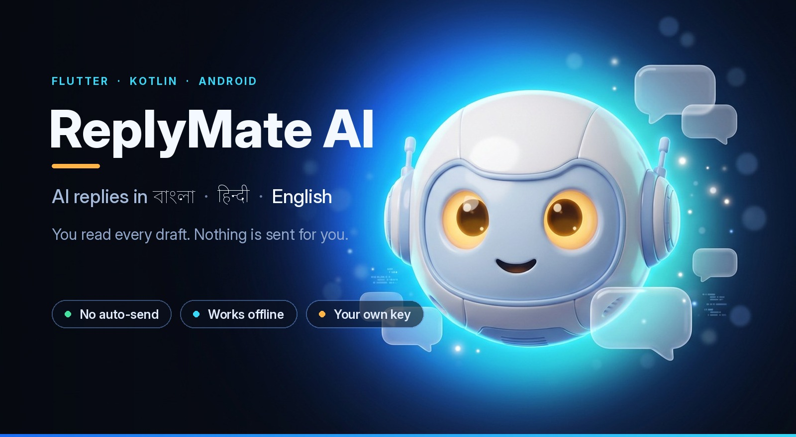

<div align="center">



<br>

**Your AI reply assistant for everyday conversations.**
Reads the message you were already sent, drafts a reply in **বাংলা · हिन्दी · English**,
and hands it to you. You edit it. **You** press send.

<br>

[](#-honest-status)
[](#-build-and-run)
[](pubspec.yaml)
[](android/)
[](test/)
[](CHANGELOG.md)
[](LICENSE)

<sub><a href="#-honest-status">Status</a> · <a href="#-features">Features</a> · <a href="#-how-it-works">How it works</a> · <a href="#-privacy-by-design">Privacy</a> · <a href="#-build-and-run">Build</a> · <a href="ROADMAP.md">Roadmap</a> · <a href="AGENTS.md">Agent playbook</a></sub>

</div>

---

## ✨ The one-line version

> Android gives ReplyMate a notification. ReplyMate gives you three replies worth reading.
> It never sends one for you.

<div align="center">

<table>
<tr>
<td align="center" width="33%" valign="top">
<br>
<strong>Catches the moment</strong><br>
<sub>Notification, share sheet, selected text, or the bubble over the app you are already in.</sub>
</td>
<td align="center" width="33%" valign="top">
<br>
<strong>Drafts where you are</strong><br>
<sub>The bubble opens a panel with the message and the suggestions — no app switching.</sub>
</td>
<td align="center" width="33%" valign="top">
<br>
<strong>Keeps you in charge</strong><br>
<sub>No auto-send in any layer. Your key stays on your phone — never in Firestore.</sub>
</td>
</tr>
</table>

</div>

## 🎯 Features

<table>
<tr><td width="50%" valign="top">

**Drafting**
- Contextual suggestions — one to three, your choice
- Six tones: friendly, professional, casual, polite, funny, short & direct
- On-demand refinement — *shorter*, *softer*, *polite decline*
- Optional context-aware follow-up question
- Conservative on-device language detection; uncertain text keeps your setting
- Explicit per-chat language, tone and length preferences, saved on-device
- Intent-based one-tap **offline** replies — no key, no network, no Firebase

**Where it works**
- Android notification capture (allowlist only)
- Share sheet and text-selection entry points
- Optional floating bubble over any app
- Optional screen reading for chats that post no notification
- Copy, edit, share — or a real RemoteInput quick reply

</td><td width="50%" valign="top">

**Cost & keys**
- **BYOK** — paste your own OpenRouter / Google AI Studio / OpenAI-compatible key
- Stored in its own Hive box on this phone: never Firestore, never a backup, never logged
- Reply cache by message hash (labelled *from cache*, with a bypass)
- Per-device daily budget with an honest stopped state
- No Firebase at all? The app still drafts offline

**Memory (opt-in, bounded)**
- Locally saved reply templates you wrote yourself
- Conversation memory: 40 lines/contact, 50 contacts, 7 days
- Turning it off **deletes** — it does not just stop
- Per-contact delete, on this device only (`allowBackup` is false)

</td></tr>
</table>

## 🔄 How it works

```text
  ┌──────────────┐   notification / share / selection / bubble
  │ messaging app│ ───────────────────────────────────────────┐
  └──────────────┘                                            ▼
                                        ┌───────────────────────────────┐
                                        │  ReplyMate (Flutter + Kotlin) │
                                        │  context → prompt → reply     │
                                        └───────────────┬───────────────┘
                     your key  ─────────────────────────┤
                     key pool (or) ─────────────────────┤
                     on-device offline suggestions ─────┘
                                                        │
                                                        ▼
                                        ┌───────────────────────────────┐
                                        │  You: read · edit · copy ·    │
                                        │  share · or quick-reply       │
                                        │  — you press send, always     │
                                        └───────────────────────────────┘
```

1. A supported app shows a notification — or you share text, select text, or tap the bubble.
2. ReplyMate receives it **only after you grant notification access**, and **only** for apps on your allowlist.
3. You ask for suggestions. ReplyMate picks the cheapest path that can answer: cache → offline heuristics → your key → key pool.
4. You get one to three drafts in your language and tone.
5. You edit, copy, share, or use the app's own quick-reply action. **The app never types into another app and never sends.**

> **Honest limits.** ReplyMate cannot guarantee access to every message or a quick-reply action in every app — that depends on the source app and Android's notification actions. Missing, grouped, redacted and truncated notifications are **shown as such**, never quietly filled in.

## 🔒 Privacy by design

| The promise | How it is actually enforced |
|---|---|
| **No automatic sending** | No send path exists in any layer. Quick reply is attempted only against a live `RemoteInput` action, and only after you tap. |
| **No message logging** | Message text lives in memory and is dropped when the panel closes. The single exception is conversation memory — opt-in, bounded, deletable, local. |
| **Nothing on disk you did not ask for** | Screen reading stores nothing. Conversation memory is the only place text may be written, and switching it off deletes it. |
| **Per-chat styles, no message text** | Only your chosen language, tone and length are stored locally. Matching uses the app and notification display name; renamed or same-name chats can match imperfectly. |
| **No cloud backup** | `android:allowBackup` is `false`. A phone backup cannot carry your key or your memory off the device. |
| **Your key is yours** | BYOK keys live in a local Hive box. Never Firestore, never rendered back on screen ("set" is the whole state shown), never logged. |
| **Nothing hidden** | `google-services.json` is never in git, and its absence never breaks a build or a screen — the app runs as a full guest shell and says what is not configured. |
| **Admin is not a public door** | Admin access requires membership of the Firestore `admin_config/access` allowlist. |

## 📊 Honest status

This is a **development build**, not a release. The README says so because the app's own
copy rules say capability claims must stay honest.

**What is verified**

- The Dart side is covered by **288 unit and widget tests** across 37 files; CI runs `dart format` → `flutter analyze --fatal-infos` → `flutter test` on every push to `main`.
- On **2026-11-06** Keshab reported a real-device smoke check confirming the admin flow, the API request and reply generation. Build details and per-step records were not captured, so this is a report, not a checklist.

**What is not verified**

- **Phase 1 device checklist — incomplete.** Quick-reply delivery, permission revocation, OEM lifecycle behaviour and the share/selection paths have no recorded device evidence.
- **Floating bubble — code-complete, not field-proven.** Rows 17–24 are still open. It may not survive aggressive OEM battery managers; the fallback notification is the reliable path.
- **Screen reading — code-complete, not field-proven.** Rows 25–34 are open. It is off by default, allowlist-bound, reads only, and cannot run under Android's Advanced Protection Mode because the system will not grant accessibility access to an app it does not classify as an accessibility tool — ReplyMate is not one and does not claim to be.
- **Hindi interface translation** needs a native speaker's review before release. The Bengali is the owner's own.
- **Release gates are unstarted**: privacy policy not published, Play Console declarations for notification-listener access and AI processing not filed, closed testing not opened.

**Known architecture debt**

The current MVP lets a signed-in client read a Firestore key pool and call AI providers
directly. The server-side proxy and rate limiting are **planned hardening, not implemented**.
That trade-off is why BYOK shipped first: a key in your own storage cannot leak out of a
shared pool, has no Firestore rules to get wrong, and burns nobody else's quota. See
[API security in the roadmap](ROADMAP.md) and [`docs/ZERO_BILL_FEATURES.md`](docs/ZERO_BILL_FEATURES.md).

## 🛠 Build and run

```bash
flutter pub get
flutter run          # guest shell: every screen works, AI + admin explain what is missing
```

The repo intentionally ships **without `google-services.json`**. Drop your own Firebase
file into `android/app/` and Firebase Auth, the Firestore key pool and the admin gate come
online. Nothing else changes — and with a BYOK key set, replies generate with no Firebase at all.

**Checks that are worth your time**

```bash
python3 tool/preflight.py        # ~1 s   before every push
python3 tool/dep_check.py        # ~2 s   are the two pinned dependencies still current?
flutter test test/<name>_test.dart   # the one test file that covers your change
flutter analyze                  # for shared surfaces and risky diffs
python3 tool/screenshots.py --shot settings-reply   # render a screen to a PNG, locally
python3 tool/see_screen.py --route /settings        # photograph a route through CI
```

`tool/screenshots.py` renders any screen the registry names — including screens you have
to tap into, which `see_screen.py` cannot reach — in about a second, with the app's real
theme and fonts, into `.agent-screens/local/` (git-ignored). It is a dev tool, not a test:
`flutter test` never discovers it and it does nothing without `--dart-define=SHOTS=1`.

No local `flutter build apk|aab|web` "just to check" — that is minutes for an artifact only
CI needs, and the signing secrets live in CI anyway. Full policy: [AGENTS.md](AGENTS.md).

## 🧱 Tech stack

| Layer | Choice |
|---|---|
| App UI | Flutter (Dart SDK `^3.13.7`), Material 3, custom navy/blue theme |
| Native | Kotlin `NotificationListenerService`, overlay bubble + foreground service, `AccessibilityService` for screen reading |
| Local storage | Hive — own-key box, templates, bounded conversation memory |
| Cloud (optional) | Firebase Auth + Firestore key pool; admin gate via `admin_config/access` |
| AI | OpenAI-compatible and Gemini `generateContent` wire formats, one shared prompt builder |
| CI | `Keshab1997/flutter-builder` reusable workflows, pinned by tag |
| Pinned deps | `admin_api_key_manager` (commit pin), `flutter-builder` (`@v1.15.2`) — `tool/dep_check.py` tells you when the pins are behind |

## 📁 Repository map

```text
lib/
├── app/            app shell, routes, tabs, theme (seed #1B6EF3)
├── core/           firebase, l10n (en/bn/hi), platform bridge, constants
├── features/
│   ├── reply/      generation, cache, budget, BYOK, offline heuristics
│   ├── notifications/  capture + allowlist
│   ├── overlay/    floating bubble panel
│   ├── screen_reading/ off by default, allowlist-bound, read-only
│   ├── memory/     bounded, deletable, on-device only
│   ├── admin/      allowlisted operator screens
│   └── onboarding/ setup/ permissions/ app_selection/ settings/ home/
├── shared/widgets/
android/            Kotlin listener, overlay service, accessibility service
test/               45 files · 345 tests
docs/               zero-bill feature plan, README media
tool/               preflight, agent_loop, ci_watch, see_screen, dep_check, make_media
design/             mascot and icon explorations
```

## 📚 Documentation

| Read this | For |
|---|---|
| [ROADMAP.md](ROADMAP.md) | phases, what is done, what is honestly not |
| [AGENTS.md](AGENTS.md) | check policy and the batch loop for AI agents |
| [PRODUCT_REQUIREMENTS.md](PRODUCT_REQUIREMENTS.md) | what the product is meant to do |
| [PROJECT_OVERVIEW.md](PROJECT_OVERVIEW.md) | architecture at a glance |
| [CHANGELOG.md](CHANGELOG.md) | what shipped, release by release |
| [docs/ZERO_BILL_FEATURES.md](docs/ZERO_BILL_FEATURES.md) | features that cost nothing to run |
| [CONTRIBUTING.md](CONTRIBUTING.md) | how to land a change |

## 🇧🇩 বাংলায়

**ReplyMate AI** — বাংলা, হিন্দি আর ইংরেজিতে রিপ্লাই লিখে দেয়। নোটিফিকেশন, শেয়ার,
সিলেক্ট করা টেক্সট বা ফোনের উপরে ভাসা বাবল থেকে মেসেজটা নেয়, কয়েকটা ড্রাফট বানায় —
**পাঠানোটা আপনি নিজে করবেন**, অ্যাপ কখনো নিজে পাঠায় না।

- নিজের API key দিতে পারেন — ফোনেই থাকে, Firestore-এ যায় না, ব্যাকআপেও ওঠে না।
- ইন্টারনেট বা key ছাড়াও অফলাইনে সাধারণ রিপ্লাই বানায়।
- কথোপকথনের মেমরি ডিফল্টে বন্ধ; বন্ধ করলে মুছে যায়, শুধু থামে না।
- **এটা এখনো রিলিজ নয়।** ফোনে সব যাচাই শেষ হয়নি — বিস্তারিত উপরের *Honest status* অংশে।

## 🙏 Credits

Mascot and app theme are the project's own. Interface type is
[Inter](assets/fonts/Inter-OFL.txt), with [Noto Sans Bengali](assets/fonts/NotoSansBengali-OFL.txt)
and [Noto Sans Devanagari](assets/fonts/NotoSansDevanagari-OFL.txt) for the scripts Inter
does not cover — all SIL Open Font License.

## 📄 License

**GNU Affero General Public License v3.0** — see [LICENSE](LICENSE) for the full text.
Copyright (C) 2026 Keshab Sarkar.

This is a deliberately strong copyleft licence, chosen because ReplyMate handles other
people's private conversations: anyone who ships a modified ReplyMate — or runs one as a
network service — has to publish their source under the same terms.

**What you may do**

- Use it, privately or commercially, on as many devices as you like.
- Study it, modify it, fork it, build your own version.

**What you must do**

- Keep the copyright notices and ship the licence with any copy you distribute.
- If you distribute a modified app — Play Store, APK, or a hosted service — the **complete
  corresponding source must be available under the AGPL-3.0**, including your changes.
- State what you changed, and keep the date.

**What it does not do**

- It is a *closed-source fork you may not make*: a proprietary or differently-licensed
  build of this code is not permitted.
- There is **no warranty**, to the extent the law allows.
- It does not relicense third-party work: the Dart/Flutter packages keep their own licences
  (`flutter pub deps`), and the bundled fonts stay under the SIL Open Font License
  ([Inter](assets/fonts/Inter-OFL.txt), [Noto Sans Bengali](assets/fonts/NotoSansBengali-OFL.txt),
  [Noto Sans Devanagari](assets/fonts/NotoSansDevanagari-OFL.txt)).

Want other terms — commercial, private, or otherwise? Ask first; a different licence can
only be granted by the copyright holder, and it cannot be applied retroactively to code
already published under the AGPL.

<details>
<summary>Header for new source files</summary>

```dart
// ReplyMate AI — Copyright (C) 2026 Keshab Sarkar
//
// This program is free software: you can redistribute it and/or modify it under
// the terms of the GNU Affero General Public License as published by the Free
// Software Foundation, version 3. It is distributed in the hope that it will be
// useful, but WITHOUT ANY WARRANTY. See the LICENSE file for details.
```

</details>

<div align="center">
<sub>Built by <a href="https://github.com/Keshab1997">Keshab Sarkar</a> · drafts, never sends.</sub>
</div>
